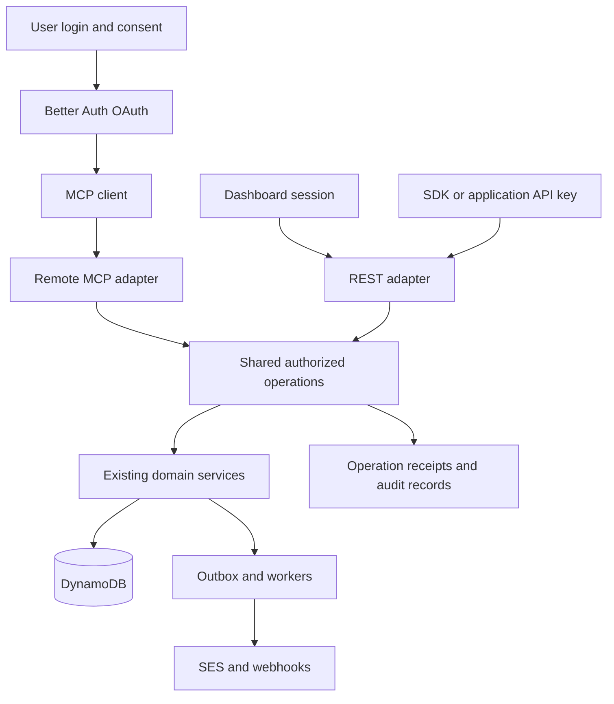

# Narada public API and agent access plan

Status: shared contracts and authorization, product and operational APIs, audience/campaign MCP tools, activity and recovery, lifecycle webhooks, and mandatory human send approvals are deployed to staging and production as of 2026-10-24. See [MCP release evidence and client coverage](MCP.md#hosted-verification), [approval migration](SEND-APPROVALS.md), [activity](ACTIVITY.md), and [webhooks](WEBHOOKS.md). SDK package publication remains separate.

Narada will expose its supported product operations through a versioned public API, a typed SDK, and an authenticated remote MCP endpoint. Dashboard and machine clients will use shared operations, authorization rules, and execution records. Users will connect an MCP client through their existing Narada login and choose all requested product permissions or a selected subset.

The first release is complete when a user can connect a supported MCP client, authorize selected permissions, prepare and optionally send a newsletter within those permissions, inspect its outcome, and reduce or revoke access with enforcement on the next request.

## Product decisions

- Keep Better Auth, Hono, DynamoDB, the existing domain services, SQS workers, outbox, and SES delivery. Add OAuth authorization to the existing API deployment.
- Ship remote MCP with user authorization as part of this release. A local API-key adapter is optional development tooling, not the completed connection experience.
- Retain the existing single owner and workspace model. OAuth represents the authenticated Narada user; it does not introduce team invitations, signup, or multi-tenant hosting.
- Offer **All requested permissions** and **Choose permissions** on the consent screen. All means an explicit snapshot of the displayed, requested, supported permissions the user may delegate. It is never a wildcard covering future features.
- Permission selection governs what the agent can request. OAuth sends and issue publication require a separate owner approval in Narada, even with all scopes. This mandatory policy supersedes the earlier optional-review proposal; other authorized operations retain their existing behavior.
- Preserve existing API-key capability ceilings, automatic application sending and SDK contracts. OAuth MCP sends require human approval even with all requested scopes. Application API keys remain server-side and must not be supplied to agents as a substitute for delegated access.
- Account recovery, MFA enrollment, owner bootstrap, OAuth grant administration, and creation of credentials remain authenticated owner-session operations in this increment. They are not included in MCP's All option. Routine product administration is included with explicit permissions.
- Treat received form answers, contact fields, and authored content as data, not instructions. Tool outputs keep content separate from authorization and execution metadata.

## Current foundation and gaps

The current checkout has public APIs and SDK methods for email submission/status, audience resources, broadcasts, and templates. Forms and publications/issues now also have shared public API/MCP handlers. Sending status/pause, metrics, SES and domain diagnostics, suppressions and webhook management now have shared public API/MCP handlers. Sender-domain registration and configuration now have shared API/SDK/MCP operations in the local onboarding increment. Domain test/removal and account/credential administration remain owner-session operations. See [agent onboarding](AGENT-ONBOARDING.md) for deployment status and owner handoffs.

Core services own the shared product rules, including operational administration. REST and MCP share authorization, operation contracts and durable mutation receipts. The dashboard and delegated sender-domain setup share domain services; the 42 audience/template/broadcast operations now have shared REST/MCP execution, with existing granular scopes, consent checks and idempotency. Transactional email send/status, template/broadcast test sends and issue delivery have MCP operations; OAuth sends require owner approval and application API keys retain automatic sending.

Existing revisions, durable acceptance, mutation receipts, scheduled publication operations, suppression checks, and uncertain-send behavior remain requirements. Agent access does not change delivery semantics or permit bypassing subscription consent.

Relevant starting points: [architecture](ARCHITECTURE.md), [API](API.md), [idempotency](IDEMPOTENCY.md), [newsletter plan](NEWSLETTERS-V1.md), `packages/core/src/runtime.ts`, `packages/core/src/api-permissions.ts`, and `packages/core/src/auth.ts`.

## Connection and consent experience

1. The owner opens **Settings → Connected apps**, copies the installation's MCP URL, and adds it to a supported client. The client can also initiate the flow directly from that URL.
2. The client discovers the protected resource and authorization server, then initiates an authorization-code flow with PKCE. Narada validates client registration/metadata, redirect URI, resource, and requested scopes.
3. The user signs in to Narada using the existing login and MFA flow. An existing valid Narada session can continue to consent. Neither the agent nor its tool arguments supply the user identity.
4. The consent page shows the Narada installation and environment, signed-in account, requesting client identity, and human-readable permission groups. Client-supplied names are not presented as verified publisher identity.
5. The user chooses **All requested permissions** or **Choose permissions**. The latter groups checkboxes by product, with individual descriptions and visible distinctions between reading, drafting, testing, publishing, sending, and administration. A read-only shortcut selects supported read permissions. Display any necessary permission dependencies; never add them silently.
6. Consent submits an explicit accepted scope list, validated server-side against the original authorization request and the user's authority. Better Auth's consent API accepts a `scope` subset. Protocol scopes such as `offline_access` are explained separately from product permissions. Refresh access is optional and its absence means reauthorization after expiry.
7. The client receives tokens containing only the accepted scope set. Partial consent succeeds when the client supports reduced grants; the server never grants omitted scopes to accommodate a client that does not. Canceling the flow issues no new grant and does not revoke a pre-existing connection.
8. Connected apps shows the client, user, resource/environment, granted permissions, restrictions, creation time, last use, and status. The owner can reduce permissions, revoke access, and inspect related activity. Increasing access requires a fresh authorization request and consent; refreshing a token never increases permissions.

An OAuth consent page cannot grant scopes the client did not request. The documented connection flow will request the supported product scope catalog when full feature selection is desired. If a client requests fewer scopes, All applies only to that request. If no product permissions are selected, the page explains that no product tools will be available and lets the user adjust or cancel.

New capabilities require new consent. Expanding an existing permission's meaning is a compatibility and authorization change, not a routine catalog edit. Both tool discovery and invocation reflect the effective current grant; hidden tools are still checked if invoked directly.

## Shared architecture

Implement an application operation boundary in `packages/core` with a trusted caller context. Session, API-key, and OAuth adapters construct that context from verified credentials; request bodies cannot set it. Include actor type, user ID when applicable, API-key or OAuth client/grant identity, installation/workspace, capabilities, resource restrictions, and request correlation.

Every operation performs authorization before resource disclosure or side effects. Compound operations authorize every relevant action and linked resource. For example, publishing an issue to web and email requires both publication and sending permissions. Template-to-broadcast and form-to-broadcast operations require source access and destination draft creation. Publication-owned topics, forms, and segments retain service-level management guards.

Extract route-owned administration into shared services as each feature migrates. REST and MCP invoke the same operation handlers. They do not call each other using a shared privileged API key. Browser origin/CSRF checks remain at the session transport boundary; OAuth requests use bearer-token validation and the same downstream authorization.

MCP tool descriptions and annotations assist clients but are never authorization controls. No tool exposes unrestricted HTTP requests, arbitrary database queries, or a generic privileged operation dispatcher.

Apply bounded payloads and shared rate limits to REST and MCP operations. OAuth limits use stable user/client/grant identities and an installation-wide ceiling, so token refresh or opening another connection cannot reset the budget. Preserve existing API-key limits. Count work per invoked operation, not just per HTTP envelope; bulk sends remain subject to current recipient limits. Distinguish request throttling from an optional grant-level sending allowance, and enforce any such allowance atomically at acceptance.

## Contracts and discovery

Add `packages/contracts` as a browser-safe package owning external input/output schemas and a declarative operation catalog. Each operation declares its stable ID, request/response shape, permission requirements, resource selection rules, side effects, idempotency support, and asynchronous result contract. Domain validation remains in core; transport schemas do not replace domain rules.

Generate OpenAPI, public SDK types, and MCP JSON schemas from these definitions. Keep curated tool descriptions and SDK convenience methods where they improve usability. Generate or validate the dashboard API examples against the same source. CI checks generated artifacts for drift and confirms every exposed operation has authorization metadata.

Expose versioned OpenAPI and authenticated capabilities discovery through the existing `/api` routing. Capabilities report installation/environment, API and contract versions, current caller permissions, supported operation IDs, pagination limits, and relevant feature limits. Anonymous documentation does not expose private resources or installation secrets.

Lists use bounded cursor pagination and useful filters. Define indexed access patterns for search before promising arbitrary full-text queries; no silent scans or truncation. Defaults return summaries, IDs, revisions, and dashboard links; detail reads retrieve content explicitly. Export endpoints support bounded pages or asynchronous artifacts rather than unbounded MCP responses.

Maintain explicit public DTOs. Storage keys, worker leases, credentials, raw provider diagnostics, signed preference URLs, and deleted email bodies remain outside ordinary responses. Preserve current v1 wire formats, timestamp units, and error codes; new operations follow the documented convention rather than silently changing old fields.

## Public API coverage and permission boundaries

The implementation inventory must map every supported dashboard product action to an operation, route, SDK method, tool where appropriate, and permission rule. The table defines required coverage; exact new scope identifiers are frozen with the catalog before implementation. Existing scope names retain their documented semantics.

| Area                    | Required public operations                                                                                     | Permission distinctions                                                      |
| ----------------------- | -------------------------------------------------------------------------------------------------------------- | ---------------------------------------------------------------------------- |
| Email                   | Submit, list/filter metadata, retrieve status and delivery events                                              | Read without send; send with sender restrictions                             |
| Contacts                | List/find/get, create, edit, subscription changes                                                              | Read, create only, edit, subscription management                             |
| Properties and segments | Definitions, membership, imports, eligibility                                                                  | Read, definition changes, membership changes, consent-attested imports       |
| Topics                  | List/get, create/edit/archive                                                                                  | Read and administration; no implied subscriber consent                       |
| Templates               | List/get, create/edit/duplicate, preview, publish/archive, test, create broadcast                              | Read, draft editing, publication, test, destination draft creation           |
| Broadcasts              | List/get, drafts, preview/preflight, test, send/schedule, cancel, recipient results                            | Read, draft editing, test, launch, cancel                                    |
| Forms                   | List/get, drafts, publish/close, responses, export, retry processing, create invitation                        | Definition read/write, publish/close, response read/export, processing retry |
| Publications            | List/get, settings, preview, activate/archive, subscribers                                                     | Read, configuration, activation/archive, subscriber access                   |
| Issues                  | List/get, drafts/duplicate, previews, test, web publish/correct/withdraw, email launch/schedule, cancel/status | Read, draft editing, test, web publication, email sending, cancellation      |
| Domains                 | List/get, register, verify, DKIM/MAIL FROM configuration, test, remove                                         | Diagnostics read, configuration, test send, removal                          |
| Suppressions            | List/filter, add, remove                                                                                       | Read, add, remove; removal does not create marketing consent                 |
| Metrics and settings    | Bounded metrics, SES diagnostics, sending status and pause/resume                                              | Read diagnostics versus changing sending state                               |
| Webhooks                | Catalog, endpoint list/create/edit/delete, delivery status/retry                                               | Configuration read/write and retry; no secret on ordinary reads              |
| Operations and activity | Status, results, reconciliation information, audit queries                                                     | Own-operation access plus explicit wider activity permission                 |

Legacy `emails:send`, `broadcasts:send`, and `templates:write` bundle actions that new consent should separate. Preserve those legacy key grants through an explicit compatibility mapping to internal capabilities. Give new granular OAuth scopes unambiguous names instead of changing the meaning of existing published scopes. The consent screen derives from the new catalog, not the legacy key permission enum.

Existing full API keys keep their current behavior for existing endpoints. Newly exposed administrative capabilities require explicit scope grants or an owner-confirmed key upgrade; rollout must not silently broaden previously issued full keys. Persist a capability version/ceiling or equivalent explicit grant snapshot during migration and replace the unconditional full-access short circuit. Prove compatibility and expansion rules in tests.

Credential management and account-security exclusions are documented in the API inventory. They remain available to the owner through existing session-authenticated flows, not mislabeled as missing product APIs.

## OAuth implementation and compatibility gate

Extend `packages/core/src/auth.ts` with compatible Better Auth MCP/OAuth and JWT support. The documented MCP plugin already composes the OAuth provider; do not register two providers. Preserve existing login, MFA, signup restrictions, secure cookies, and auth rate limiting.

Serve MCP under `/api/mcp`. Wire authorization-server and protected-resource discovery paths to Hono and CloudFront, including required root `/.well-known/*` paths. Discovery, token responses, and private tool output are not CDN cached. Canonical issuer and resource URLs use the configured installation origin. Staging and production have distinct issuers/resources and cannot accept each other's tokens.

Pin compatible package versions and verify the actual protocol and client-registration behavior of the supported Claude and Codex clients. Support standards-based metadata registration where available; enable a bounded dynamic-registration compatibility path only if a supported client needs it. Do not assume that a current server example's protocol version works with every installed client.

Before feature rollout, prove the following against the pinned DynamoDB adapter and isolated real DynamoDB Local tables:

- Required plugin models, lookup indexes, uniqueness, pagination, signing-key persistence, and expiry handling.
- Authorization-code single use under concurrent exchanges and refresh-token rotation under concurrent refreshes.
- Resource/audience binding, issuer validation, reduced consent, scope preservation on refresh, and wrong-client rejection.
- User login and MFA continuation through consent; replay, malformed redirects, denial, and expired flows.
- Grant reduction and revocation enforcement for already-issued access tokens, refresh attempts, and direct tool invocation.

The adapter reports no interactive multi-record transactions. If a required provider access pattern or atomicity guarantee is unsupported, fix or extend that adapter integration before rollout. A successful password login is not evidence of OAuth concurrency correctness. Do not introduce a database replacement without documenting the demonstrated incompatibility and migration impact.

## Delegation enforcement and lifecycle

Effective authority is the intersection of current user permissions, token scopes, the current connection grant, and applicable resource/action restrictions. Resource restrictions apply to every route that reaches the capability, including nested and compound operations. Initial restriction types are sender domains and selected existing publications/forms; collection discovery and direct ID reads both enforce them. Unsupported combinations are rejected, not silently treated as unrestricted.

Maintain a durable connection authorization record linked to the provider's user/client/resource grant. It owns Narada policy, scope ceiling, status, and authorization epoch; provider records continue to own OAuth protocol state. The token must be verifiably associated with that record, through supported claims or an unambiguous validated lookup, never a client-supplied grant ID.

Each MCP request verifies the token and reads current grant/user authority consistently. Signature validation alone cannot make revocation immediate. Scope reductions take effect through the current grant; revocation blocks new requests even with an unexpired token. Reconnection or permission expansion must invalidate old authorization epochs so old tokens cannot regain rights. No positive grant cache in the first release. Grant-store failure fails closed.

Where a durable mutation commits, conditionally check the grant epoch/status with the acceptance transaction where feasible. External effects still have an in-flight boundary; revoke does not recall an already-started SES submission. These boundaries must be documented and tested rather than described as instantaneous cancellation.

Already accepted queued or scheduled work continues under its recorded authorization; revoking a connection prevents new calls, not previously accepted delivery. Connected apps explains this and links to pending work and explicit cancellation. Workers continue checking domain validity, pause state, publication state, opt-outs, and suppressions. They never require storing an OAuth access or refresh token in a job.

For OAuth send operations, use prepare → owner review → atomic acceptance. Preparation captures the action, sender, content, channels, recipients and personalization values, schedule and expiry. The owner decision executes the action and consumes the approval atomically; changed content or audience requires a new request. Agent-supplied `confirmed: true` and broad scope consent never substitute for this. Delivery checks may remove newly ineligible recipients but cannot add unapproved recipients. API-key automation retains existing behavior and can opt into this review workflow. See [Send approvals](SEND-APPROVALS.md).

Agent grants cannot mint credentials, edit their own scopes, or approve their own pending actions. Human scope consent never stands in for recipient subscription consent.

## Observable and recoverable execution

Move reusable mutation coordination below HTTP while retaining existing receipt behavior and the optimized email acceptance path. REST and MCP use a stable operation identity and canonical input digest. API-key operations retain compatible namespaces; OAuth operations are namespaced by installation, user, stable connection grant, and operation ID, not the rotating access token. Refreshing a token must not create a new logical operation.

MCP mutations require a stable caller operation key, represented in their input schema. SDKs accept the same key explicitly. Retries reuse it; adapters must not generate a new key per attempt. Keep current retention/replay limits and require reconciliation after that window. Permanent resource-level guards still prevent duplicate issue distributions after receipt expiry.

Return `requestId`, `operationId` where applicable, resource references, revision, acceptance state, and a status link. Add authorized operation lookup that projects receipts and existing jobs into documented states such as accepted, running, succeeded, failed, canceled, and unknown. Operation completion is distinct from mail delivery. Unknown results never trigger automatic fresh-key replay or fallback sending. Conflicts identify whether the caller should reload a revision, retry the same request later, or reconcile an uncertain result.

Record actor/user/client/grant identity, operation, target resource, policy decision, timestamps, outcome, and correlation IDs. Use transactionally committed audit/outbox records for accepted mutations and correlate worker progress with the same operation. Ordinary reads and denials use bounded structured activity logging with an explicit retention policy. Proposed default audit retention is 90 days, configurable per installation; do not retain raw request bodies, tokens, email bodies, form answers, or recipient lists in audit records. Resource content follows its existing retention contract.

Expose owner-visible activity and pending operations; scoped agents can inspect their permitted operations without obtaining broader resource access. Recheck current authorization before replaying any stored response, especially responses containing one-time webhook secrets.

Extend the existing webhook outbox with supported form-response, issue-publication, and broadcast-completion events. Define each completion state precisely; dispatch completion is not proof of recipient delivery. Event IDs, signatures, at-least-once delivery, and receiver deduplication remain unchanged. Event-driven agents run externally; this release does not add an embedded autonomous agent scheduler.

## Implementation sequence and completion gates

The shared contracts, product/operational APIs, campaign and transactional MCP operations, activity/recovery, lifecycle webhooks and mandatory human send approval are deployed to staging and production. See [contracts](OPERATION-CONTRACTS.md), [send approvals and migration](SEND-APPROVALS.md), and [hosted verification](MCP.md#hosted-verification). The compatibility correction was verified on the maintained staging and production installations on 24 October 2026: API-key sends are unattended within existing permissions, while approval remains mandatory for OAuth MCP sends. Earlier approval-for-all reports describe a superseded policy. Source changes and each installation’s deployment remain separate release steps.

| Increment                       | Deliverable                                                                                                            | Completion gate                                                                                                |
| ------------------------------- | ---------------------------------------------------------------------------------------------------------------------- | -------------------------------------------------------------------------------------------------------------- |
| 1. OAuth feasibility            | Isolated Better Auth integration, discovery routing, login/MFA, selected-scope consent, one identity/capabilities tool | Real supported client connects; reduced scopes, refresh, concurrency and revocation pass against DynamoDB      |
| 2. Contracts and authorization  | Operation/scope catalog, shared schemas, caller context, resource policy, legacy-key mapping, generated OpenAPI        | Every exposed operation has a permission rule; existing API/SDK contracts pass unchanged                       |
| 3. Product API parity           | Forms, publications/issues, operational reads and management endpoints, bounded discovery, SDK coverage                | Inventory accounts for every product action and explicit owner-only exclusion; cross-feature permissions pass  |
| 4. Remote MCP and connection UX | Curated tools, complete all/selected consent, connected apps, resource restrictions, mandatory human send review       | Agent completes a permitted workflow; direct invocation cannot bypass omitted scopes or review policy          |
| 5. Operations and activity      | Shared retry coordination, operation reads, audit UI, lifecycle webhooks                                               | Lost responses, stale revisions, duplicate jobs and uncertain outcomes are recoverable without duplicate sends |
| 6. Release verification         | Documentation, client compatibility matrix, staging rehearsal, migration/rollback notes                                | End-to-end workflows pass through real CDN/auth/client paths before separately authorized production release   |

Authorization, idempotency, and audit hooks accompany each newly exposed mutation; increment 5 completes their cross-product visibility rather than retrofitting protection after launch. Keep unfinished MCP exposure gated through the sequence. These are reviewable increments, not a requirement for one large change.

## Acceptance scenarios

- Connect with All and with selected scopes. The token contains exactly the permitted accepted set. New scopes added later do not appear in an existing grant, including after refresh.
- A read-only connection can inspect allowed metrics and resources but cannot create drafts, send tests, publish, change preferences, or configure webhooks, even by calling a hidden tool or REST operation directly.
- A draft-and-test connection can request an allowed test for owner approval, but cannot request a subscriber send without its target scope. Every OAuth send and issue publication requires a human decision, including connections granted all scopes.
- Publish web only, email only, and both with the appropriate individual or combined permissions. Corrections never resend email. An issue cannot escape publication restrictions through its underlying broadcast or managed segment.
- Access restrictions apply to list results, direct IDs, exports, previews, tests, template-derived senders, and linked resources. Form-response access is separate from form-definition access.
- Reduce or revoke access while an old token is still valid. Subsequent requests fail or lose the removed rights. Reconnecting does not reactivate an old token. Already accepted work remains visible and separately cancelable.
- Lose the response after a mutation commits, refresh the token, then retry with the same operation key: return the same resource/result. Changed payloads conflict. An uncertain external side effect remains unknown until reconciled.
- Attempt concurrent code exchanges, refreshes, mutations, approvals, and cancellation races. No duplicate credential grants, emails, issue distributions, or approval consumption occur.
- Inspect all discovery metadata, errors, DTOs, audit entries, and webhook payloads for private storage fields and content leakage. Imported content cannot change permissions or action policy.
- Preserve legacy API keys and SDK workflows, owner login/MFA, subscription consent, suppression, retention, and single-workspace boundaries.

Run relevant unit, integration, browser, SDK package, and infrastructure checks per increment. The final staging rehearsal covers CloudFront discovery routing, secure issuer/resource origins, supported real MCP clients, consent reduction, revoked-token behavior, and a controlled SES test. Local Mailpit remains the default for development.

## Documentation references

- [Better Auth MCP plugin](https://better-auth.com/docs/plugins/mcp) describes the provider composition and protected MCP handler. Package/protocol compatibility must be pinned during increment 1.
- [Better Auth OAuth Provider consent endpoint](https://better-auth.com/docs/plugins/oauth-provider#consent-endpoint) documents submitting an accepted `scope` subset. The selection and connected-app screens are Narada product work.
- [MCP authorization](https://modelcontextprotocol.io/specification/2026-07-28/basic/authorization) defines resource discovery and delegated authorization for the referenced protocol revision. Supported clients determine required compatibility coverage.

Future product features must add the operation contract, permission mapping, SDK/API documentation, MCP exposure decision, and execution/recovery semantics as part of their delivery.

## Publication branding coverage update

Local source now includes `publications.logo.upload`, `publications.branding.preview`, and `publications.branding.update` across REST, SDK, and MCP. Branding writes use the explicit new `narada:publications:branding:write` scope; previews use publication read. Publication/sender restrictions, asset associations, live grants and receipt replay remain enforced by shared operations.

The existing global media upload/library stays owner-only. Publication-scoped PNG/JPEG logo upload closes the machine-client gap for this feature without granting workspace-wide media discovery. Custom-domain provisioning and email-design branding are outside this release. This inventory does not assert deployed/published availability; see [branding scope and validation](PUBLICATION-BRANDING-V1.md).

Owner password changes and recovery sender configuration remain owner-only account-security operations, deliberately excluded from public REST v1, the Node SDK and OAuth MCP. Use [Profile → Security](PROFILE-SECURITY.md). Existing API keys, public DTOs and delegated permissions are unchanged.

## Custom publication subdomains

See [publication subdomains](PUBLICATION-DOMAINS.md) for the five shared management operations, dedicated domain-write consent, DNS/HTTPS setup, asynchronous recovery and default-address fallback. The local implementation includes dashboard, API, SDK and MCP coverage; deployment and SDK publication are separate release steps. DNS-provider writes remain an operator action.
