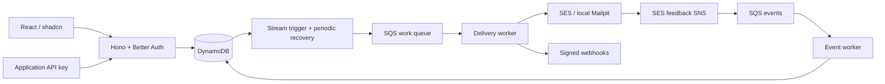

# Architecture and operations

## Boundaries

The API validates HTTP requests and delegates to the core services. Domain rules live in `packages/core`, outside Hono and React. `Store`, `Queues`, and `Transport` contain provider-specific code. Local and Lambda entrypoints use the same service and queue handlers. The SDK depends only on HTTP.

`packages/contracts` owns the public operation/scope catalog and DTOs, generates structural JSON Schemas and self-contained SDK types, and drives authenticated capability/OpenAPI discovery. `packages/core/src/authorization.ts` is the shared server policy boundary for public REST and production OAuth/MCP. Existing keys use an explicit capability ceiling; delegated callers use the token/grant/consent intersection. See [operation contracts](OPERATION-CONTRACTS.md) for resource restrictions and [MCP](MCP.md) for consent, revocation and rollout details.

`createRuntime` is the composition root: it constructs one shared `SubscriptionService`, `ContactService`, `TemplateService`, and `WorkDispatcher`, then injects the appropriate instances into email, broadcast, and form services. Routes use `runtime.contacts`, `runtime.subscriptions`, and `runtime.templates` directly. Existing constructors and forwarding methods remain compatible for callers outside the runtime.

`WorkDispatcher` owns durable job publication and expired-lease recovery for emails, broadcasts, forms, newsletters, and webhooks. Both worker entrypoints call it directly. `EmailService.dispatch()` remains a compatibility forwarding method. Queue publication precedes deferral; conditional claims still tolerate duplicate jobs. An expired email submission is marked uncertain and its content removed, never automatically resubmitted.

The frontend has feature directories for authentication, email, domains, keys, webhooks, and settings. Generated shadcn primitives remain in `components/ui`; shared form/layout components, the API client, and data hooks are separate. Browser imports of server model types are type-only. Raw email HTML previews are sandboxed; visual composition uses the React Email/Tiptap editor with sanitized source conversion.

## Data and delivery

Application records use PK/SK plus `byScope` and `byState` indexes. A separate auth table uses the DynamoDB Better Auth adapter's documented primary and lookup keys. Both AWS tables have TTL and point-in-time recovery and are retained when a stack is deleted. Production OAuth adds an indexed signing-key ring and requires six auth lookup GSIs. Durable grants and per-user reset generations live in the application table; every MCP request checks them without a positive grant cache. Workers initialize auth lazily and do not require auth-table access. Core/auth package versions are pinned; adapter upgrades require reviewing its schema and running the auth integration tests.

An accepted message and its idempotency record are written in one DynamoDB transaction. The message itself is the durable outbox item. A stream trigger enqueues new work; a one-minute sweep recovers missed publication and scheduled retries. Local development sweeps every second. Publication can occur more than once; worker state changes use conditional writes.

Workers transition `queued → submitting → sent` (or `captured` locally). Explicit SES throttling is retried with backoff. A timeout/disconnection may occur after SES accepts an email, so an ambiguous submission becomes `unknown` and is **not** automatically resent. SES does not provide an idempotency key for SendEmail: Narada does not promise exactly-once delivery. Inspect SES feedback/provider records before manually deciding to submit again with a new key. Expired messages are not sent.

Feedback transactions deduplicate events, update message history, create suppression records, and create webhook jobs atomically. Complaints and permanent bounces do not regress when events arrive out of order. Transient bounces are delays. The message status is an aggregate; recipient details are retained in events. Only the latest 100 events are shown per message.

Sending is blocked for suppressed recipients both at acceptance and immediately before transport submission. A suppression arriving after the final pre-send check cannot recall an in-flight message. The pause control stops new acceptance and queued submissions, not already in-flight sends.

## Security and secrets

- Better Auth runs in the application with DynamoDB-backed sessions, hashed passwords, TOTP, recovery codes and single-use reset tokens. Public signups are disabled. Bootstrap is an IAM-only Lambda, never an HTTP endpoint.
- Shared auth rate limits use conditional DynamoDB counters with TTL. No scans or Redis are required. API Gateway also throttles deployed HTTP traffic.
- Management requests require a session; mutations require the exact configured Origin. The CloudFront and local Vite proxies keep the UI/API on one origin.
- API-key plaintext is returned once; only hashes and a display prefix are stored. Sending keys optionally restrict email submission and status lookup to an exact sender domain. Full-access keys can use the frozen set of existing public resource APIs across the workspace; future operations are not granted implicitly. Legacy keys remain unrestricted email sending/status credentials. The server checks the resolved sender, including template defaults, before accepting a message.
- Authenticated public requests record best-effort `lastUsedAt` metadata with a conditional update at most once per minute per key. A stale request cannot overwrite revocation. Legacy keys have no historical timestamp; tracking begins on their next use. This adds no resource or background polling, but does consume DynamoDB writes when activity timestamps advance.
- Production auth secrets live in SSM SecureString, read at cold start. They are provisioned idempotently by deployment code, never embedded in the CloudFormation template. Keep the secret stable across redeployments.
- Webhook secrets remain in the encrypted-at-rest application table. Requests sign the exact raw JSON body with HMAC-SHA256. Receivers must verify timestamp/signature and deduplicate event IDs.
- External webhooks require HTTPS and public IPv4 DNS answers; IPv6 destinations are deliberately unsupported in this version. DNS results are validated again and pinned when opening the connection; redirects are not followed. Only the exact local capture endpoint is exempt in local mode.
- Local mode always uses dummy AWS credentials and loopback/container service endpoints. It has no SES transport. Development event injection routes do not exist in AWS mode.

## Retention, failures, and recovery

Message metadata, feedback deduplication, and webhook jobs expire after 30 days. Message bodies are removed once submission completes or ends without a retry; see [retention](MESSAGE-RETENTION.md). Idempotency records expire after 24 hours. DynamoDB TTL deletion is asynchronous; idempotency expiry is also checked in application code. Suppressions remain until deliberately removed. Better Auth validates expiry even before TTL cleanup removes sessions/tokens.

Webhooks retry with exponential backoff, at most six attempts per manual retry cycle. Token-fenced claims and per-attempt history commit atomically; stale lease recovery records an unknown outcome, and a late worker cannot overwrite a newer attempt. Lifetime attempt history survives manual retry. Webhook delivery is at least once: recipients must deduplicate by `webhook-id`. Removing an endpoint prevents future queued deliveries; an already in-flight request can still complete.

SQS has separate work and event dead-letter queues and CloudWatch alarms. Worker handlers use partial batch failures. Inspect the DLQ and Lambda logs before redriving. Never blindly replay an uncertain email send. Alerts exist in CloudWatch but no external notification subscription is created automatically.

Restore DynamoDB tables using point-in-time recovery, update the stack/runtime table references, and validate sessions, suppression records and pending work before resuming sends. Retained tables and frontend buckets are intentionally not deleted by stack removal. Back up the SSM auth secret separately as part of your account recovery procedure.

## Deployment limits

One AWS account and region per installation. The deployment provisions the dashboard on an AWS CloudFront domain. Optional custom domains use an operator-provided ACM certificate and external DNS; see [custom domains](CUSTOM-DOMAIN.md). SES identities are created from the dashboard; DNS changes and SES production access require the account/domain owner. The bootstrap owner email should stay stable for a stage.

The Emails overview counts describe the latest 100 messages. The Metrics page uses separate daily aggregates beginning with messages accepted after metrics were enabled. Database indexes may briefly lag after a write. Local DynamoDB/ElasticMQ approximate AWS behavior; they do not validate real IAM permissions, CloudFront forwarding, SES reputation or AWS service quotas. Run a cloud smoke test before switching production traffic.

## Audience data and personalization

`ContactService` owns shared profiles, directory projections, typed properties, segment rules, topic administration, and legacy membership migration. `SubscriptionService` owns subscription reads/writes, signed unsubscribes, global opt-outs/resumption, import opt-ins, and recipient eligibility. `BroadcastService` uses its batch eligibility check before freezing recipients and personalized values; email delivery uses the same policy against fresh records immediately before submission. Directory subscription status remains distinct from delivery suppression. Transactional emails do not use marketing preferences.

Verified form signup remains a single database transaction. `ContactService.prepareVerifiedProfile` and `SubscriptionService.prepareSignup` return guarded writes and webhook jobs without committing them. `FormService` commits those alongside its response revision and processing marker. A concurrent profile edit or topic opt-out rejects the whole transaction; a retry reads current state and never replaces an existing topic preference. Global/legacy opt-outs are retained, and normal signup does not implicitly resume them. Existing keys, signature formats, consent sources, API responses, and data retention remain unchanged; no data migration is needed. All records share the existing application table. See [Broadcasts](BROADCASTS.md) for schemas, limits, migration behavior, and local testing.

## Templates

`TemplateService` owns alias uniqueness, revision-protected drafts, immutable publication snapshots, archive checks, and server-side rendering. `template-model` validates typed variables and interpolation contexts. `TEMPLATE`, `TEMPLATE_ALIAS`, and `TEMPLATE_VERSION` records live in the existing app table. Publication updates metadata and creates a version atomically. Email acceptance stores fully resolved content; broadcast reuse copies a published template into an independent draft. The shared `email-editor` frontend feature owns visual/source editing and sandboxed previews for both workflows; template features own library state, variable definitions, and publication controls.

`message-content.ts` owns the shared structured-document, HTML, and plain-text contract and escaping helper. Templates, broadcasts, and the editor reuse that contract without tying content to an audience, sender, schedule, or unsubscribe footer. Existing limits and stored shapes are preserved. This contract validates structure and size; it is not an HTML sanitizer or a public-web renderer.

### Newsletters

The [Newsletter v1 plan](NEWSLETTERS-V1.md) describes the product scope and release checks. `PublicationService` owns branding, slug reservations, activation and archival, together with a managed topic, dynamic audience and versioned signup form. Generic resource editors reject changes to these managed definitions. Shared contacts become eligible through explicit publication-topic consent; the 1,000-recipient send limit applies after eligibility filtering, not to the shared directory.

`IssueService` owns revision-protected drafts, immutable `ISSUEVERSION` records, public pointers and durable `PUBLICATIONOP` records. Its allowlisted renderer derives both channel outputs from structured editor content. Publish-now commits the version, public pointer, operation and optional broadcast/snapshot in one transaction alongside the HTTP mutation receipt. Scheduled broadcasts remain in `publication-held` until a conditional worker transaction exposes the web version and releases the same broadcast. Deterministic operation identities and issue revisions prevent duplicate sends after lost responses or queue retries. No worker lease is needed for the single atomic release transition.

Public corrections create new immutable versions without replacing or redistributing the frozen email. Archival disables the topic and signup form atomically, immediately preventing future eligibility; a durable, paginated cleanup cancels pending schedules and broadcast expansion. Public archive content is independent of message-content retention. Subscription preferences also carry an additive per-topic index used for newsletter subscription counts; existing topic behavior and preference keys remain compatible.

`/n/*` routes are server-rendered by the API through a separate, uncached CloudFront behavior and local Vite proxy. Public projections exclude private versions and recipient data; archive entries are checked against current issue records before rendering. Signup uses the existing confirmed-form transaction, explicit POST confirmation, neutral responses, per-email cooldowns and publication confirmation limits. Signed pages are no-store/no-referrer/noindex; native form posts with a null Origin require browser-controlled same-origin fetch metadata. Owner routes remain session-authenticated under `/api/admin/publications`; the public API/SDK now expose publications and issues through explicit operation keys. `ProductOperations` in core authorizes collection/direct/linked resources and applies public DTOs before response or receipt storage; see [product API](PRODUCT-API.md).

## SES status and settings

The settings frontend separates SES visibility, sending controls, recipient suppression, and account security into independent panels sharing shadcn tabs and a section layout. Panels remain mounted to preserve in-progress forms. `GET /api/admin/settings` reads the lightweight application sending state; `GET /api/admin/settings/ses` reads a whitelisted account/configuration-set snapshot. Both require an owner session. The SES reader avoids AWS entirely in local mode, coalesces concurrent reads, and caches successful AWS results for 30 seconds. Unknown fields remain null; failed reads are not cached. CDK grants read-only account access and scopes configuration-set reads to Narada's configuration set. No new resources are provisioned. Pool changes, quota enforcement, and warm-up scheduling are outside this settings UI change.

## Metrics and outbound events

`metrics.ts` owns recipient counters and bounded daily reads. Acceptance atomically writes the message, idempotency record, daily accepted-recipient increment, and first-tracking timestamp. Successful transport submission records an idempotent submission marker and captured/submitted count. Feedback atomically updates message outcome-recipient sets, daily counters, suppression records, deduplication records, and webhook jobs. Counts are grouped by message acceptance date in UTC; original SES event timestamps and bounce categories are also preserved. Outcome sets prevent double counts even for duplicate recipient notifications with different event IDs. Old messages without `metricsVersion: 1` are excluded to keep numerator and denominator consistent. Aggregates intentionally have no TTL and contain no recipient addresses or message contents.

`GET /api/admin/metrics?days=15&domain=example.com` accepts 1–90 days and requires an owner session. Each day is a bounded, strongly consistent query of `METRICS#YYYY-MM-DD` / `DOMAIN#sender`; a domain filter uses direct item reads. There are no message scans, CloudWatch API calls, or background dashboard refreshes. Snapshot reads span multiple queries, so activity arriving while a snapshot loads may appear on the next refresh. AWS console access is an external regional link. Metrics exclude direct auth mail, non-Narada SES traffic, and history preceding enablement.

`webhook-events.ts` is the shared supported-event catalog. `event-outbox.ts` constructs jobs for subscribed endpoints and provides atomic mutation-plus-job writes. Contact creation/import, profile edits, topic creation/edits, topic preference writes (including CSV opt-ins and unsubscribe), domain administration, suppressions, form response receipt/processing, issue releases, and broadcast completion use this outbox. Lifecycle transitions use stable event IDs and commit their deliveries with the guarded transition. See [lifecycle definitions and delivery history](WEBHOOKS.md). The existing dispatcher and SQS worker deliver these jobs with the existing signing, DNS pinning, leases, retry backoff, and manual retry behavior. No additional event bus is necessary. Subscription lookup uses the existing endpoint index and is eventually consistent immediately after endpoint configuration changes. Legacy endpoints without an events field retain only their existing email events. There are at most five endpoints; even a ten-recipient bounce with all subscriptions remains under DynamoDB's 100-action transaction limit.

## Resource removal and response recovery

Domain and API-key removal share a name-confirmation dialog. The admin API independently checks the exact name, authenticated owner session, and request origin. `POST /api/admin/keys/:id/revoke` disables authentication; `DELETE /api/admin/keys/:id` permanently deletes only an already-revoked record. Both require `{confirmation: "exact key name"}`. Lookup follows index pages and then reads the key consistently; deletion conditionally verifies revocation in DynamoDB.

`DELETE /api/admin/domains/:name` requires `{confirmation: "exact.domain"}`. Removal keeps a tombstone outside the active domain index scope and sets verification false. It does not call SES deletion or modify DNS. New sends fail validation and workers check the domain again before submitting queued work. A submission past that final check may still complete. Verification refreshes cannot overwrite removed-domain tombstones. Deliberate re-addition resets the registration; existing scoped keys remain usable after re-addition, while queued messages retain the previous registration ID and cannot be revived by re-adding the domain. Legacy registrations and messages use a shared legacy marker until the domain is removed and re-added. Direct auth mail bypasses the Narada domain registry and can continue using the retained SES identity. Email and metrics history remain intact.

The dashboard HTTP client accepts 204 responses, preserves JSON API errors, and explains empty or non-JSON responses without exposing parser errors. Mutations are not retried automatically because the response may be lost after a successful write. Resource hooks ignore stale responses after a newer refresh or unmount, and successful domain changes refresh the list to clear stale read errors.

## Domain authentication checklist

`domain-authentication.ts` maps SES identity snapshots and bounded public DNS checks into the optional `Domain.authentication` snapshot. `domain-authentication-model.ts` provides shared types without pulling Node DNS or AWS libraries into the browser. DNS TXT fragments are joined; DMARC queries the exact domain, then the organizational domain determined by the pinned `tldts` public-suffix list. An invalid explicit policy is not bypassed by parent inheritance. NXDOMAIN/no-data is distinct from lookup failures. Checks use a two-second resolver timeout with one attempt per query; MAIL FROM MX and TXT queries run independently in parallel. No CloudWatch API, polling task, new database, DNS writing permission, or extra AWS resource is introduced.

Authenticated admin endpoints configure custom MAIL FROM (`PUT /domains/:name/mail-from`), enable DKIM signing (`POST /domains/:name/dkim`), and enqueue a test (`POST /domains/:name/test`), under `/api/admin`. Settings use SESv2 identity APIs; the API role gains only the corresponding identity-scoped SES write actions. The domain snapshot is written using the existing active-registration guard/outbox. AWS configuration and DynamoDB cannot be one transaction: a response or persistence failure after a successful SES change may leave the snapshot stale; the next manual verification reads actual SES state. Local mode never invokes SES or public DNS and persists simulated MAIL FROM choices across checks. Test emails use normal acceptance, suppression, queue, domain-removal safeguards, and worker transport.

The frontend separates DKIM records, DMARC proposals, MAIL FROM configuration, test sending, and shared record-copy controls into components. The setup tabs retain in-progress form state. A verified identity badge does not stand for a DKIM/DMARC/SPF pass. DMARC proposals never write DNS, and stricter policy is an explicit choice. Tests cover DNS failures, split TXT records, duplicate policies, inheritance, command payloads, local isolation, endpoint permissions, responsive browser flows, and Mailpit capture. Real SES permissions, DNS propagation and internet inbox placement still require cloud validation.

## Release model for maintainers and agents

The [production release instructions](../README.md#deploy-production-manually) are the operator runbook. Keep them synchronized with [release.yml](../.github/workflows/release.yml), [deploy.yml](../.github/workflows/deploy.yml), and [ci.yml](../.github/workflows/ci.yml) when changing delivery behavior.

- Pull requests run validation without AWS deployment credentials.
- A push to `main` validates and deploys staging only.
- Production requires a new manual `workflow_dispatch` run of **Release Narada** on `main` with `deploy_production=true`. That run validates and deploys the same revision to staging before its production job can start.
- This is manual initiation, not a GitHub required-reviewer approval gate. There is no separate approval pause after staging succeeds, and users with workflow-run permission can initiate production.
- Both environments use AWS OIDC and their own account. CI preserves existing owner credentials and auth secrets. Public smoke tests check the frontend/API, not authenticated owner flows or actual email delivery.

Preserve manual production initiation when maintaining the workflows unless the user requests a change to the release policy. A documentation or staging change does not itself request a production promotion. Workflow conditions define the implemented behavior; environment protections are additional GitHub settings and must not be assumed to provide a reviewer gate.

## Operation feedback

The dashboard mounts one shadcn-style Sonner `Toaster` alongside the app root, so notifications survive navigation and dialog dismissal. It uses Narada's theme, bottom-right placement, mobile insets, a close button, and polite announcements. Successes remain for 4.5 seconds; failures remain for 8 seconds. Form errors also remain inline.

Feedback is explicit at the user-action boundary. For a single API operation, pass a success message as the fourth `api` argument; successful parsing (including HTTP 204) is required before showing success. Read hooks and polling are silent by default. For compound operations, wrap the entire operation with `withFeedback`, keeping the individual API calls silent. `ActionForm` accepts `successMessage`, and `ConfirmRemovalDialog` requires it. These shared components already handle failure notifications, so their callbacks should not wrap requests a second time. Template publishing reports one final result after save and publish both complete. Sending actions report queued or scheduled, never delivered.

`copyWithFeedback` reports completion only after clipboard access succeeds and never includes the copied value. Keep secrets and full response objects out of toast text. Existing busy controls and confirmation dialogs continue to own interaction state; notifications do not replace those safeguards or retry uncertain mutations.
